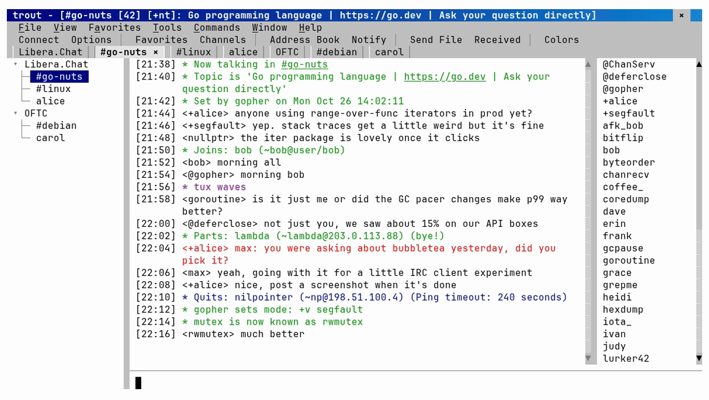

# trout

An mIRC-inspired IRC client for the terminal. It looks and works like the mIRC you
remember, menus, switchbar, treebar, nicklist popups, Address Book and all, and connects
through a [soju](https://soju.im) bouncer, which keeps you online and keeps your history
while trout is closed. No bouncer? trout sets one up for you.


trout is a hobby project. There's no hosted service and nothing to sign up for.

## What you need

- A terminal with mouse support and 24-bit color: iTerm2, Ghostty, kitty, WezTerm,
  Alacritty, Windows Terminal, GNOME Terminal, Konsole.
- A bouncer, or not: trout connects to a soju you already have, sets one up on a Linux
  server you can SSH into or on a new server at Hetzner Cloud, DigitalOcean or Google
  Cloud's free tier, or runs one itself on this computer while it's open.
- Go 1.25 or later to build it.

## Install and run

```sh
brew install --cask maxrenaud/tap/trout     # macOS and Linux
trout                 # the Connect dialog the first time, then your saved bouncer
trout --demo          # a fake world, no network: look around first
```

Or download an archive for macOS, Linux or Windows (Intel/AMD or ARM) from
[Releases](https://github.com/MaxRenaud/trout/releases) and run `trout` from where you
unpack it: the soju it installs and runs comes in the same archive, next to it. From
source, `go install github.com/MaxRenaud/trout/cmd/trout@latest` works too, and
`dev/build-soju` builds that soju.

trout isn't signed yet. Homebrew takes care of that on macOS; from a downloaded archive,
macOS says it can't check trout: run `xattr -dr com.apple.quarantine` on the unpacked
folder once. On Windows, SmartScreen may warn the first time: More info, then Run anyway.

The first run asks for the bouncer's address (`ircs://host[:port]`), user and password,
or offers to set one up (Set One Up) or to run one here (This Computer).
The password goes in a `credentials` file (mode 0600) next to `config.toml`, in your
config folder (`~/Library/Application Support/trout` on macOS, `~/.config/trout` on
Linux, `%AppData%\trout` on Windows). Over TLS, after a password login, trout asks the
bouncer to remember this computer's certificate and logs in with that from then on.

Flags and environment variables override the config: `--addr` / `TROUT_ADDR`,
`--user` / `TROUT_USER`, `--password` / `TROUT_PASSWORD`, `--config` / `TROUT_CONFIG`,
`--bouncer` to pick a saved one. `password-command` in `config.toml` runs a command such as
`pass show soju` for the password.

## Getting a bouncer

Tools > Set Up Bouncer installs soju for you: on a Linux server you can SSH into (it uses
your own `ssh`, so `~/.ssh/config` and your agent just work, and sudo, a sudo password or a
command you run yourself for root), or on a new server it makes at Hetzner Cloud,
DigitalOcean or Google Cloud (pick a region, see the price, Create Server). It makes a TLS
key and pins it, so there's no domain to buy, checks the bouncer by logging in, and moves
your networks onto it. Tools > Bouncers updates or removes it later, deleting the server
too.



This Computer runs soju right here instead, while trout is open, for when there's no
server. Tools > Connect a Phone shows a QR code that opens your bouncer in
[Goguma](https://goguma.im) (iPhone and Android), which gets soju's push notifications.

## What's in it

- mIRC's layout: menubar, toolbar, switchbar, treebar, nicklist, the editbox, Windows 98
  dialogs, and mIRC's colors and formatting codes (Ctrl+B, Ctrl+K, Ctrl+U...).
- The bouncer's networks as mIRC's servers: Connect, Disconnect, Select Server and
  `/server` go through soju.
- History: windows fill in from the bouncer, read markers sync with your other clients,
  Ctrl+F can search the bouncer's whole history.
- Channel Central (modes, bans, exceptions, invites, topics), the Channels List,
  Favorites, the Address Book (notify, ignore, auto-op and protect, nick colors,
  highlights), Perform, CTCP, DCC Get and Chat, Send File through the bouncer's file
  host, URL catching, timestamps, the line marker, Options pages and the Colors dialog.
- The multi-line editbox (Alt+Enter), the second editbox (Alt+Q), per-window options in
  each button's popup, a proxy (SOCKS4, SOCKS5, HTTP) for the bouncer and DCC.
- mIRC scripts and the Scripts Editor (see [Scripting](#scripting)).

F1 lists the keys. Right-click, Ctrl+click or a long press opens popups.


## Scripting

trout runs mIRC scripts: aliases, popups, events, variables, timers, hash tables, files
and the Users list, for the scripts that automate things (auto-op, greetings, `!seen`,
trivia). The Scripts Editor (Tools > Scripts Editor, or Alt+R) works like mIRC's, with its Aliases,
Popups, Remote, Users and Variables tabs and its files, so yours can be copied over. Every
right-click menu comes from `popups.ini`, so you can change them. Not mIRC's dialogs,
custom windows or DLLs, which need Windows. See [docs/scripting.md](docs/scripting.md).

## Terminal notes

**Mac: Alt is Option.** trout's Alt shortcuts need the Option key to send Alt, as in
WeeChat or Emacs. trout checks at startup and offers to fix it: in iTerm2 it uses a copy
of your profile with the left Option key as Alt while trout runs; in kitty and Ghostty it
adds one line to their config; elsewhere it shows the setting to change. Ctrl+J also
starts a new line in the editbox.

**tmux** works. For the mouse, focus (for the bell) and 24-bit color, put this in
`~/.tmux.conf` (the last line names your outer terminal's `TERM`):

```
set -g mouse on
set -s focus-events on
set -s escape-time 10
set -as terminal-features ',xterm-256color:RGB'
```

**Windows:** tested on Windows 11 in Windows Terminal, This Computer and Set Up Bouncer
included (it uses Windows' own OpenSSH).

## Developing

`docker compose -f dev/compose.yaml up -d --build` starts two IRC networks, soju and a
chatty bot; `dev/trout` connects to it. `go test ./...` runs the unit and screen tests;
`go test -tags integration ./internal/ui` runs against the dev servers. See
`docs/dev-environment.md` and `docs/architecture.md`. `dev/vhs/record` records the GIFs
here from `dev/vhs/*.tape`, in [VHS](https://github.com/charmbracelet/vhs)'s container.

## License

MIT (see `LICENSE`). The soju trout installs and runs is a separate program under the GNU
AGPL v3; release archives include its license and where its source is.
